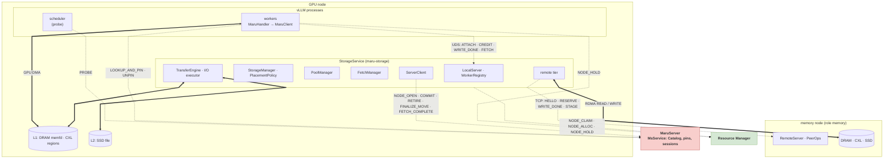
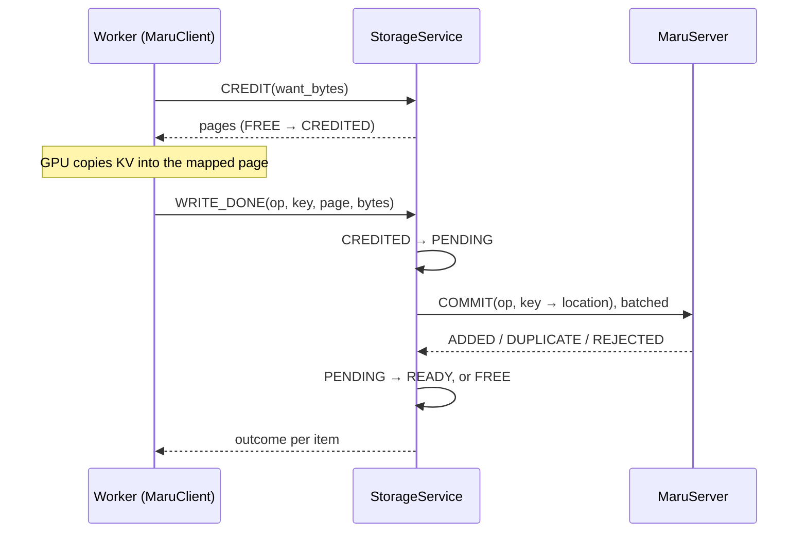
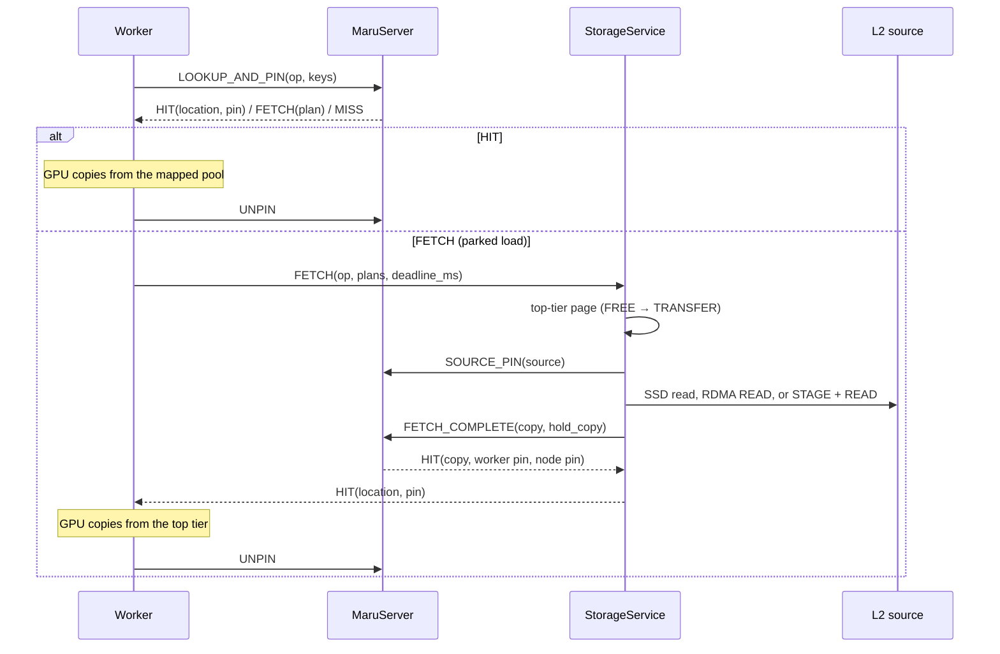
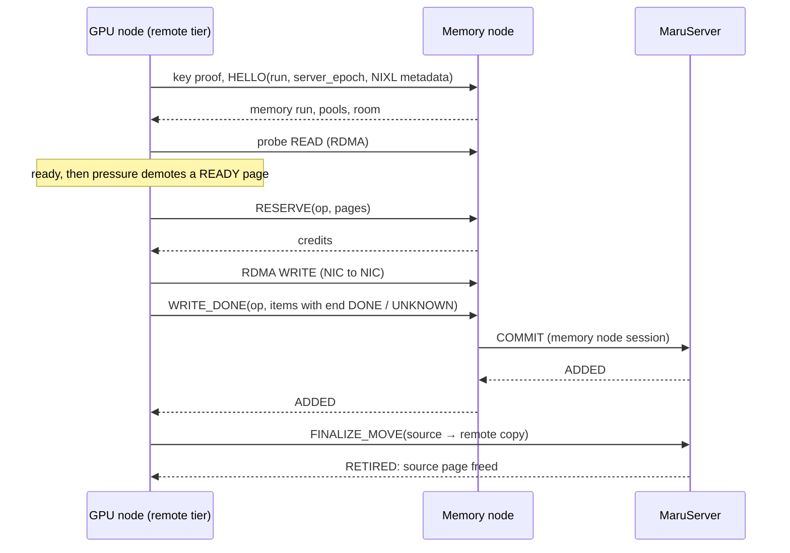

# Node StorageService

A **StorageService** (`maru-storage`, package `maru_storage_service`) runs once per node and owns the node's KV pools for every vLLM instance on it. Workers copy KV between the GPU and the pools it lends them; the StorageService moves pages between tiers, to other nodes and back; MaruServer's **Catalog** records which KV exists and where. A *memory node* is a StorageService with `role: memory`: it has no workers and serves the tiers of GPU nodes over RDMA.

---

## 1. Summary and Goals

- **One owner per node.** The StorageService creates or claims every pool of the node (DRAM, CXL regions, an SSD file) and lends pages to workers as *credit*; all vLLM instances on the node share them.
- **The Catalog is the source of truth.** MaruServer's `MsService` (`maru_server/ms_service.py`) keeps key → locations for every node: a key in the Catalog exists, a key absent from it does not. Nodes publish with `COMMIT` (`FETCH_COMPLETE` for a fetched copy) and remove with `RETIRE` or `FINALIZE_MOVE`.
- **Tiers.** Pages move down by pressure (write-back) or are copied down as written (write-through), and come back into the top tier on demand (*fetch*). Workers only touch the pools they map.
- **Memory nodes.** A GPU node's last tier can be the DRAM, CXL and SSD of memory nodes, reached with one-sided RDMA that only the GPU node's StorageService posts.
- **Opt-in.** A vLLM instance takes this path when its connector sets `maru_node` (the StorageService socket), else `maru_storage_backend` as before.

**Coexistence.** The node path runs beside the storage backends selected by `maru_storage_backend` (`cxl`, `cpu`, `mixed`, `remote_cxl`). One MaruServer process serves both on separate request lanes, but the Catalog (messages `0x40`–`0x5F`) and the `KVManager` of the storage backends are separate: a key stored on one path is not visible on the other. Sharing CXL memory across hosts uses the `cxl` backend.

---

## 2. Components



> Dashed arrows carry metadata; thick arrows carry KV bytes.

### 2.1 Worker side

The vLLM connector calls `MaruHandler`, which on `maru_node` delegates to `MaruClient` (`maru_handler/client/`). `StorageConn` is the `AF_UNIX` connection to the StorageService (MaruServer's framing; the `ATTACH` reply carries the DRAM memfds with `SCM_RIGHTS`). `ServerConn` is the worker session at MaruServer. `PoolMaps` maps the pools page-locked for GPU DMA, holding each CXL region in the RM (`NODE_HOLD`) while mapped, and checks every location against them before a byte is touched. The vLLM scheduler attaches as a *probe*: no pool, credit or pin, `PROBE` only.

### 2.2 StorageService

| Component | Role |
|---|---|
| `LocalServer` | The UDS endpoint (mode 0660); checks the peer with `SO_PEERCRED` |
| `WorkerRegistry` | Attached workers, watched by pidfd; an exit quarantines the worker's credit for the GPU drain grace (5 s), then is reported (`WORKER_EXIT`) |
| `StorageManager` | Credit, `WRITE_DONE` → `COMMIT`, eviction, demotion, write-through, `RETIRE`, deletes, worker exits |
| `PoolManager` | Page tables: states, generations, credit budgets, quarantine, I/O references |
| `PlacementPolicy` | LRU candidates and watermarks per tier; it proposes, MaruServer decides |
| `TransferEngine` | Copies between the node's own mappings outside metadata locks, paced to a bandwidth budget; L2 pages move by their tier's I/O (SSD: an I/O executor, reads first) |
| `FetchManager` | Serves `FETCH` (section 4.3) |
| `ServerClient` | The node session at MaruServer; resends each op until its result is known or the MaruServer run ends |
| Remote tier, `RemoteServer`, `PeerOps` | Memory node pages for a GPU node, and a memory node's side (section 5) |

`Node` runs StorageService *runs* one after another in one process. Each run has a fresh `node_epoch`, and MaruServer numbers a node's runs (`epoch_seq`). A run ends on its own when MaruServer restarted or ended it, when an op's result stays unknown, or when the RM lease is lost; `Node` then starts a new run, and workers re-attach without a vLLM restart.

### 2.3 MaruServer

`MsService` holds the `Catalog` (key → locations: pool, allocation, generation, offset, length, kind), the `NodeRegistry` (node, worker and probe sessions), the `PinManager` (pins on exact locations, never expiring by time) and an `OpLedger` (replay records). A lookup returns per key the cheapest location the requester **maps** (`HIT`, pinned for the worker), else the cheapest its node can **fetch** with both StorageServices up (`FETCH` with a plan, no pin), else `MISS` (`offline` if the key still has a location, else `absent`). Cost order: own DRAM < own CXL < memory node DRAM/CXL < own SSD < memory node SSD. A worker maps its node's DRAM and CXL of the run it attached to; it can fetch its node's SSD, a memory node's DRAM and CXL when its node has `remote_v1` and the owner `memory_v1`, and a memory node's SSD when both also have `stage_v1`. Hits MaruServer sees are reported to the owning node in heartbeat replies, for its LRU.

The node path needs no RM at MaruServer (`--cpu-only` serves it). Its settings are `--session-ttl-s` (30 s), `--heartbeat-s` (a third of the TTL), `--node-give-up-s` (600 s), `--op-window`, `--op-bytes-max` and `--policy-file` (keys preserved from eviction); `python -m maru_server.ms_admin delete` removes keys through their nodes.

### 2.4 Resource Manager: node-owned regions

A node's CXL tier owns its regions **as the node**, so the RM's PID reaper and grace period never take them:

- **Claim.** Before `NODE_OPEN` a run sends `NODE_CLAIM` with its `node_epoch`: the RM makes it the node's current run (bound to its host) and lists the node's regions and holds. The run allocates up to the tier `size` with `NODE_ALLOC`, one `region_size` each.
- **Lease.** The run renews (`NODE_RENEW`) every 10 s, or a quarter of the lease if that is shorter; the RM frees a node's regions after `--node-lease` (900 s) without a claim, alloc or renew from its current run. A run that cannot renew for half the lease lets go and a new run starts; a run another run claimed stops for good.
- **Holds.** Each mapping is held per run: a worker as `<incarnation>@<node_epoch>`, the StorageService's own as `ss@<node_epoch>`. The RM never reallocates a held range, even after release or lease end. A hold ends with `UNHOLD` after unmapping; the StorageService drops an exited worker's holds after the drain grace, and the RM drops a hold `--hold-grace` (5 s) after its holder is gone, or at once after a reboot.
- **Adoption.** A new run claims the same regions; their pages stay quarantined while an earlier run still holds them (`NODE_HOLDS`, polled once a second).

See [maru-rm-ctl](../api_reference/maru_rm_ctl.md) (`release-node`, `drop-holds`) for nodes and holders gone for good.

### 2.5 Endpoints

| Endpoint | Messages |
|---|---|
| StorageService UDS (`maru_common/node_protocol.py`) | `ATTACH`, `DETACH`, `CREDIT`, `CREDIT_RETURN`, `WRITE_DONE`, `ABORT`, `FETCH`, `FETCH_CANCEL`, `UNMAP_ACK`, `NOTIFY` (`credit_return`, `pool_add`, `pool_remove`); `LOCAL_PIN`/`LOCAL_UNPIN` answer `DISABLED` |
| MaruServer, node | `HANDSHAKE` (after an `EPOCH` reply), `NODE_OPEN`, `NODE_HEARTBEAT`, `NODE_CLOSE`, `NODE_RECOVER_LIST`, `WORKER_EXIT`, `SOURCE_PIN`, `COMMIT`, `RETIRE`, `FINALIZE_MOVE`, `FETCH_COMPLETE`, `UNPIN` |
| MaruServer, worker / admin | `WORKER_OPEN`, `WORKER_HEARTBEAT`, `WORKER_CLOSE`, `PROBE`, `LOOKUP_AND_PIN`, `UNPIN` / `ADMIN_DELETE` |
| Memory node (`maru_common/remote_protocol.py`) | `HELLO`, `PING`, `GOODBYE`, `RESERVE`, `WRITE_DONE`, `CANCEL`, `DROP`, `STAGE`, `UNSTAGE` |
| Resource Manager | `NODE_CLAIM`, `NODE_ALLOC`, `NODE_FREE`, `NODE_RENEW`, `NODE_RELEASE`, `NODE_HOLD`, `NODE_HOLDS`, `UNHOLD` |

Capabilities: `fetch_v1` (a worker may `FETCH`, agreed at `ATTACH`); `remote_v1` (GPU node with a remote tier), `memory_v1` (memory node) and `stage_v1` (SSD staging), accepted by MaruServer at `NODE_OPEN`.

---

## 3. Request Flows

**Start.** A run claims its socket, opens its tiers, claims its CXL regions, sends `NODE_OPEN` with its pools, reloads adopted pools (section 6.4) and only then accepts workers. A worker `ATTACH`es with its engine, ranks, pid, namespace, KV layout and objects per step; the reply carries the run, MaruServer's address, the page size, pool descriptors, budgets and transfer defaults. An `ATTACH` whose object is larger than the page is refused.

### 3.1 Store



Workers hold credit ahead of time and refill it in the background, so a store takes a page without an RPC. Credit is bounded per worker and per node; a waiting worker makes the node ask idle ones to return credit (`NOTIFY credit_return`), and none is given while stores awaiting `COMMIT` reach `commit_pending_max_bytes`. A store without credit is skipped, or deferred when the caller retries it later. `WRITE_DONE` follows the completed GPU copy, `ABORT` the drain of submitted GPU work. A key is visible once `COMMIT` lands, so its bytes are complete before any reader finds it; a `DUPLICATE` frees the new page.

### 3.2 Load



A `HIT` is read directly from DRAM or CXL; no StorageService is on that path. `FETCH` serves parked (asynchronous) loads with `fetch_v1`. A miss is recomputed by vLLM.

---

## 4. Tiers

### 4.1 L1 and L2

| Store | Level | Pools | Bytes moved by |
|---|---|---|---|
| `dram` | L1 | One memfd per run, fully allocated and sealed at creation, on huge pages unless `hugepage: false` | Workers (GPU DMA), the node |
| `cxl` | L1 | The node's RM regions (section 2.4) | Workers (GPU DMA), the node |
| `ssd` | L2 | One preallocated, locked `O_DIRECT` file; its header names the owning node and counts its opens | The node only |
| `remote` | L2 | Memory nodes' pools | The node only (RDMA) |

The first tier must be L1: workers copy to it and get credit from it. A `cxl` tier below `dram` gives the credit DRAM lacks (`credit_fallback`). A GPU node serves `[dram]`, `[cxl]` or `[dram, cxl]`, each optionally followed by one `ssd` or one `remote` tier; a memory node the same without `remote`.

Page states: `FREE`, `CREDITED` (lent to a worker or peer run), `TRANSFER` (a demotion, fetch or staging destination), `PENDING` (committing), `READY` (published), `RETIRING` (removed; freed once no I/O reference remains) and `QUARANTINED` (not reused until no access is proven). A pool an earlier run may still write is quarantined as a whole: it gives no credit, its pages that would become `FREE` become `QUARANTINED` instead, and its `READY` pages are still read and retired. A page gets a new generation each time it leaves `FREE`, its high bits naming the run; MaruServer refuses a `COMMIT` with another run's generation, and `RETIRE`, `DROP` and `SOURCE_PIN` name exact locations.

### 4.2 Eviction and demotion

An eviction pass runs every 50 ms, lowest tier first. A tier above its `high_watermark` offers LRU candidates until it is back at its `low_watermark`. Per tier, `demotion` is:

- **`back`** (default). Pressure moves READY pages down: reserve a page below, copy (memcpy, SSD write or RDMA WRITE), `COMMIT` the copy with a *finalizer* (a remote copy is committed by the memory node, section 5.3), then `FINALIZE_MOVE` removes the source atomically at MaruServer. A pinned source stays (`KEPT`) and is retried. Without room below the pages wait, but while the tier is past its high watermark they are dropped: writes never stall.
- **`through`**. Pages that become READY are also copied down at once, best effort, within `through_max_inflight` bytes in flight (past it a page is skipped). The copy is committed without a finalizer; pressure later only finalizes the source onto it.
- **The last tier** evicts with `RETIRE`; MaruServer keeps a pinned or preserved location (`KEPT`).

A source with a READY copy below (write-through, or the SSD or memory node page a fetch read) is finalized onto it without writing again. A remote tier never evicts: the memory node owns and tiers what it committed.

### 4.3 Fetch from L2

`FetchManager` runs one *flight* per key: one top-tier page and one read, shared by every `FETCH` of the key. A flight takes its page (asking eviction for room if needed), pins the source (`SOURCE_PIN`), reads it, and publishes the copy with `FETCH_COMPLETE`, which commits it, pins it for the worker and releases the source pin in one request; the first completion also pins the copy for the node (`hold_copy`) until every waiter has its own pin. `FETCH`es short of room take pages in arrival order, so two never deadlock. Sources are the node's SSD, a memory node's DRAM or CXL (one RDMA READ), or a memory node's SSD: `STAGE` loads the exact page into a staging page there, which the GPU node READs and releases with `UNSTAGE`.

A `FETCH` is answered when every item has an outcome, or at its deadline or cancel with `MISS` for items without a pin. The deadline is `maru_fetch_deadline_ms` (250 ms), or pages × `maru_fetch_deadline_per_page_ms` (default: one page at 2 GB/s) if longer, at most 60 s; `fetch_request_max_bytes` caps one `FETCH` and `fetch_max_inflight_bytes` the node's reads in flight.

---

## 5. Memory Nodes

### 5.1 Role and NIC registration

A memory node is a StorageService with `role: memory` and its own tiers. It binds a `RemoteServer` instead of the UDS and registers each L1 pool **whole** with its NIC before `NODE_OPEN`; a top-tier pool that cannot be registered fails the start, another is left out of the run. It asks MaruServer for `memory_v1` (and `stage_v1` with an SSD tier) and fails the start if refused. Pages GPU nodes write become its own once committed: it demotes them by its own pressure (DRAM → CXL → SSD) and retires them like any other page. Each run creates its own NIXL agent, with UCX limited to transports whose NIC checks the remote key (`rc`, `dc`) and the registration cache off; the agent ends after every pool is deregistered.

### 5.2 RemoteServer and PeerOps

The `RemoteServer` is one TCP endpoint per memory node run (`remote_server.listen`); both sides prove a shared key before any frame. `HELLO` comes first and is refused for another wire version, `server_epoch` (`BUSY`), `page_size`, a retired GPU node run or a missing `remote_v1`, and answered `BUSY` while the memory run is not serving yet; accepted, it returns the memory run, its pools (base and NIXL metadata; SSD pools without either) and the peer's *room*. A `HELLO` from another run of the same GPU node retires the earlier run, as does `GOODBYE`. Ops carry the GPU run as origin (`peer:{node_id}@{node_epoch}`), and their results stay in a per-run ledger across connections until acknowledged. `STAGE` runs on a bounded pool; a full queue answers `BUSY` unrecorded.

`PeerOps` gives a GPU run credit as a worker gets it (`RESERVE`). `WRITE_DONE` commits the items that ended `DONE` (with the memory node's own session) and quarantines those whose end is `UNKNOWN`. `CANCEL` returns credit never posted (a `CANCEL` that overtakes its `RESERVE` leaves a tombstone); `DROP` retires one key at one exact location. **Release evidence** for a page a transfer may touch is only a transfer that ended `DONE` or one never posted. Credit past `reserve_ttl_s`, unknown writes, and the credit and staging pages of a run whose connection ended or that was retired are quarantined under that run; the same run's evidence (replayed after a reconnect) releases them, otherwise they stay until the memory run ends. At `peer_quarantine_max` for a GPU node, or `quarantine_max` for the node, peers get no room.

### 5.3 GPU node remote tier



The `remote` tier is a GPU node's last tier and lists memory nodes in `url`. Its run registers the node's L1 pools whole with the NIC and asks for `remote_v1` and `stage_v1` only if all are registered (else it serves its local tiers only). A memory node is *ready* once `HELLO` is answered, its pools' metadata loaded and a probe READ ended `DONE`. Demotion reserves from the ready memory node with the most room, at most 8 WRITEs in flight each, writing only credit of the current connection and memory run. MaruServer accepts a `FINALIZE_MOVE` without finalizer only onto an active pool of a `memory_v1` node, from a `remote_v1` node, checking the exact copy under its lock.

**Only `DONE` ends a transfer.** One that ends in an error or runs past `timeout_s` is *kept*: the tier takes its local page (a WRITE source stays READY with an I/O reference, a READ destination is quarantined) until a late `DONE` or the run's end. NIXL's errors for a gone peer (remote disconnect, or a peer agent NIXL invalidated after its connection failed) end a transfer in an error and release its handle; its pages stay kept. Kept and running pages count against `quarantine_max`, and no transfer is posted that could pass it; at the cap remote plans miss and demotion finds no room, while the local tiers keep working.

**Connections.** A lost connection is retried every 5 s and a ready one pinged every 5 s for its room. Ops are numbered per memory run: one whose answer was lost is resent with the same sequence after reconnecting to the **same** run, and dropped if the memory node is a new run. When a memory node's TCP stream ends, it stops being ready at once and every fetch reading from it on that connection misses (`offline`) before its deadline; posted transfers are polled to their end or timeout.

---

## 6. Consistency and Failure Handling

### 6.1 What protects a page

| Protection | Held at, by | Keeps | Released |
|---|---|---|---|
| Pin | MaruServer, worker | An exact location from `RETIRE`, demotion, eviction and delete | `UNPIN` after the GPU reads; `WORKER_CLOSE`; `WORKER_EXIT` after the drain grace; a new run's `NODE_OPEN` (pins of earlier-run workers); the node closing (its workers' pins outside CXL); a node given up. Never by time |
| Finalizer | MaruServer, node | A demotion copy until its source is removed | `FINALIZE_MOVE`, or the run's end |
| Source pin, copy node pin | MaruServer, node | A fetch source while read; a fetched copy while waiters pin it | `FETCH_COMPLETE`, or `UNPIN` if the read fails; `UNPIN` once the last waiter has its pin |
| Preserve | MaruServer policy | A key from eviction and delete (not demotion) | While listed |
| Credit | StorageService, worker or peer | A page lent for writing | `WRITE_DONE`, `ABORT`, `CREDIT_RETURN`, `CANCEL` |
| I/O reference | StorageService | Source and destination of a running copy, I/O or RDMA | Its actual end |
| Quarantine | StorageService | Pages whose last access is unproven | Evidence, or the end of its cause |
| Hold | RM, each mapping per run | A region's range from reallocation | `UNHOLD` after unmapping; the StorageService for an exited worker; the RM after its holder is gone (`--hold-grace`) or a reboot; `maru-rm-ctl drop-holds` |
| Node ownership | RM, node | Its regions from other nodes | Release on leave, or lease end |

Pins do not expire by time because a read pin is what keeps a page from reuse while a worker copies it to the GPU.

### 6.2 Ops

Every state-changing request carries an op: origin, sequence, payload digest and ack (the highest sequence whose result the sender holds, with all below). The receiver keeps results per origin until acknowledged; a resend gets the first result, a reused sequence with another digest is refused, a full window answers `BUSY`. This holds on all three links: worker → StorageService (`CREDIT`, `WRITE_DONE`, `ABORT`, `FETCH`), node or worker → MaruServer (every state change, and `LOOKUP_AND_PIN`), and GPU node → memory node. `UNPIN` is idempotent by pin id. An op to MaruServer is resent only within the same MaruServer run, and one to a memory node only within the same memory node run.

### 6.3 No byte lands in a page after it may be reused

- **Workers.** `WRITE_DONE` follows the copy, `ABORT` the drain. An exited worker's credit stays quarantined for the drain grace and its pins until `WORKER_EXIT`. A pinned location cannot be retired, so a page being read is not reused.
- **Node copies and SSD I/O.** A page with an I/O reference never becomes `FREE`; SSD I/O drains before the file lock is released.
- **RDMA.** Only `DONE`, or a transfer never posted, releases a page. Otherwise the GPU node keeps it until a late `DONE` or its run's end, and the memory node quarantines it until that GPU run's evidence or the memory run's end. A mapping is unmapped only after its NIC deregistration succeeded; if that fails, the process exits, ending its registrations. With key-checked transports and no registration cache, a late WRITE to a deregistered range fails at the NIC.
- **Runs.** Each run has a new DRAM memfd (the old one lives until its last worker mapping goes), new RM holds, a new NIXL agent and new generations. Pools taken over stay quarantined while the earlier run may still write them.

### 6.4 Failures

| Event | Behavior |
|---|---|
| MaruServer restart | New `server_epoch`, empty Catalog: KV is recomputed. After an `EPOCH` reply a node tells a restart from an expired session with `HANDSHAKE`; on a restart it starts a new run: a new DRAM pool, the same CXL regions (quarantined until no earlier access remains), the SSD file reused from scratch. Workers drop the ended epoch's pins and re-attach |
| StorageService restart, same boot | DRAM KV is gone. CXL regions are claimed again: committed pages return `READY` (`NODE_RECOVER_LIST`), the rest stay quarantined while an earlier hold remains. The SSD pool is adopted only if unchanged and opened exactly once since, under the same MaruServer run. Both need the node back within `--node-give-up-s` |
| Worker exit | Credit quarantined for the drain grace, then freed; `WORKER_EXIT` releases its pins; its RM holds are dropped |
| Memory node crash and restart | GPU nodes see the TCP stream end: pending fetches miss at once, posted transfers that do not end `DONE` stay kept. Its pools go offline at MaruServer once its session expires (`--session-ttl-s`) or its new run opens; until then fetches planned to it miss at the GPU node at once. A process killed outright closes its sockets only after the kernel has released its memory, so a fetch already waiting then may run to its deadline. The new run adopts its CXL and SSD pools; GPU nodes reconnect, drop the old run's credit and hit the adopted pages |
| GPU node crash | The memory node quarantines the run's credit and staging pages; KV it committed stays readable by other GPU nodes. The restarted GPU node's `HELLO` retires the old run |
| GPU ↔ memory node TCP lost | The memory node quarantines the run's outstanding credit and staging pages; the GPU node reconnects to the same run and replays unanswered ops, whose evidence releases it |
| Node ↔ MaruServer partition | Ops are resent; an expired session reopens with the same `node_epoch`, keeping pins, pools and op records. Worker lookups miss after `maru_lookup_timeout_ms`. A node away past `--node-give-up-s` loses its locations and starts a new run |
| Worker ↔ StorageService | The worker unmaps unused pools and re-attaches: to the same run it keeps credit and resends unresolved ops; to a new run it drops them |

---

## 7. Configuration

`maru-storage --config node.json` reads a JSON node config (unknown keys are errors); `--check` validates it and prints it with defaults filled in; whether its tiers can be served is checked at start. SIGTERM closes the run with `restart`, which keeps the CXL regions in the RM.

| Key | Default | Meaning |
|---|---|---|
| `node_id` | required | Letters, digits, `.`, `_`, `-`; starts with a letter or digit |
| `role` | `gpu` | `gpu` or `memory` |
| `socket`, `socket_group` | `/run/maru/node.sock`, — | Workers' UDS (GPU node) and its group |
| `server` | required | MaruServer's ZMQ address, e.g. `tcp://host:5555` |
| `page_size` | required | Holds one object: a chunk of every layer of a rank's KV, or one layer with layerwise storage |
| `tiers` | required | Ordered, top first |
| `budgets` | derived | Below |
| `remote_server` | — | Memory node only, and required there |
| `local_pin` | `false` | Must be false |

| Tier key | Stores | Default |
|---|---|---|
| `size` | `dram`, `cxl`, `ssd` | required (`"64G"`) |
| `demotion` | `dram`, `cxl` | `back` (or `through`); not on the last tier |
| `through_max_inflight` | `dram`, `cxl` with `through` | 256 MiB |
| `high_watermark`, `low_watermark` | `dram`, `cxl`, `ssd` | 0.9, 0.8 |
| `hugepage` | `dram` | `true` (start fails without huge pages) |
| `region_size`, `rm` | `cxl` | 1 GiB (a multiple of `page_size`), `127.0.0.1:9850` |
| `visibility`, `credit_fallback` | `cxl` | `coherent` (or `flush`); `true` below the top tier |
| `path` | `ssd` | required, absolute |
| `url` | `remote` | required: memory node `host:port`, a list or comma-separated |
| `rdma_device`, `timeout_s`, `key_file`, `quarantine_max` | `remote` | UCX's choice, 30 s, `~/.maru/remote-cxl-agent.key`, 1 GiB |

`budgets`: `credit_total_max_bytes` (25% of the credit tiers' size), `credit_max_bytes` (the node total, in whole pages), `credit_refill_high` (16 pages or 512 MiB, whichever is more, at most `credit_max_bytes`) and `credit_refill_low` (a quarter of it), `commit_pending_max_bytes` (the credit total), `transfer_reserve_bytes` (5% of each memory tier, at least one page on the top tier of a node that fetches; one size or `{store: size}`), `fetch_request_max_bytes` (1 GiB), `fetch_max_inflight_bytes` (4 GiB).

`remote_server`: `listen` and `key_file` (required), `rdma_device`, `reserve_ttl_s` (60 s), `peer_quarantine_max` (twice `credit_max_bytes`), `quarantine_max` (an eighth of the registered L1 bytes), `stage_workers` (4), `stage_queue` (64).

A GPU node with DRAM (writing through), CXL and SSD:

```json
{
  "node_id": "gpu-a",
  "socket": "/run/maru/node.sock",
  "server": "tcp://maru-server:5555",
  "page_size": "32M",
  "tiers": [
    {"store": "dram", "size": "64G", "demotion": "through"},
    {"store": "cxl", "size": "256G", "region_size": "1G", "rm": "127.0.0.1:9850"},
    {"store": "ssd", "size": "2T", "path": "/mnt/nvme0/maru"}
  ]
}
```

A GPU node whose DRAM demotes to memory nodes, and a memory node:

```json
{
  "node_id": "gpu-b",
  "server": "tcp://maru-server:5555",
  "page_size": "32M",
  "tiers": [
    {"store": "dram", "size": "64G"},
    {"store": "remote", "url": ["10.0.0.21:5600", "10.0.0.22:5600"], "rdma_device": "mlx5_0:1"}
  ]
}
```

```json
{
  "node_id": "mem-1",
  "role": "memory",
  "server": "tcp://maru-server:5555",
  "page_size": "32M",
  "remote_server": {"listen": "0.0.0.0:5600", "key_file": "~/.maru/remote-cxl-agent.key"},
  "tiers": [
    {"store": "dram", "size": "256G"},
    {"store": "cxl", "size": "1T", "rm": "127.0.0.1:9850"},
    {"store": "ssd", "size": "8T", "path": "/mnt/nvme0/maru"}
  ]
}
```

**vLLM connector.** In `kv_connector_extra_config`, `maru_node` is the StorageService socket; `maru_engine_id` and `maru_cache_namespace` are required. Pool sizes, tiers, page size, RDMA settings and MaruServer's address belong to the node config, so the storage-backend keys are refused with `maru_node`. Node-path settings include `maru_lookup_timeout_ms` (100), `maru_credit_wait_ms` (0) and `maru_fetch_deadline_ms` (250); `maru_async_load` and `maru_async_store` default to what the node advises; loads are parked anyway under vLLM async scheduling, above TP=1, or with several KV cache groups. See the [vLLM integration guide](../integration/vllm.md).

---

> **See also:** [Architecture Overview](architecture_overview.md), [MaruServer](maru_server.md), [MaruHandler](maru_handler.md), [Resource Manager](maru_resource_manager.md), [Consistency and Safety](consistency_and_safety.md), [CPU/CXL L1 and SSD L2 (Proposal)](tiered_kv_cache.md)
